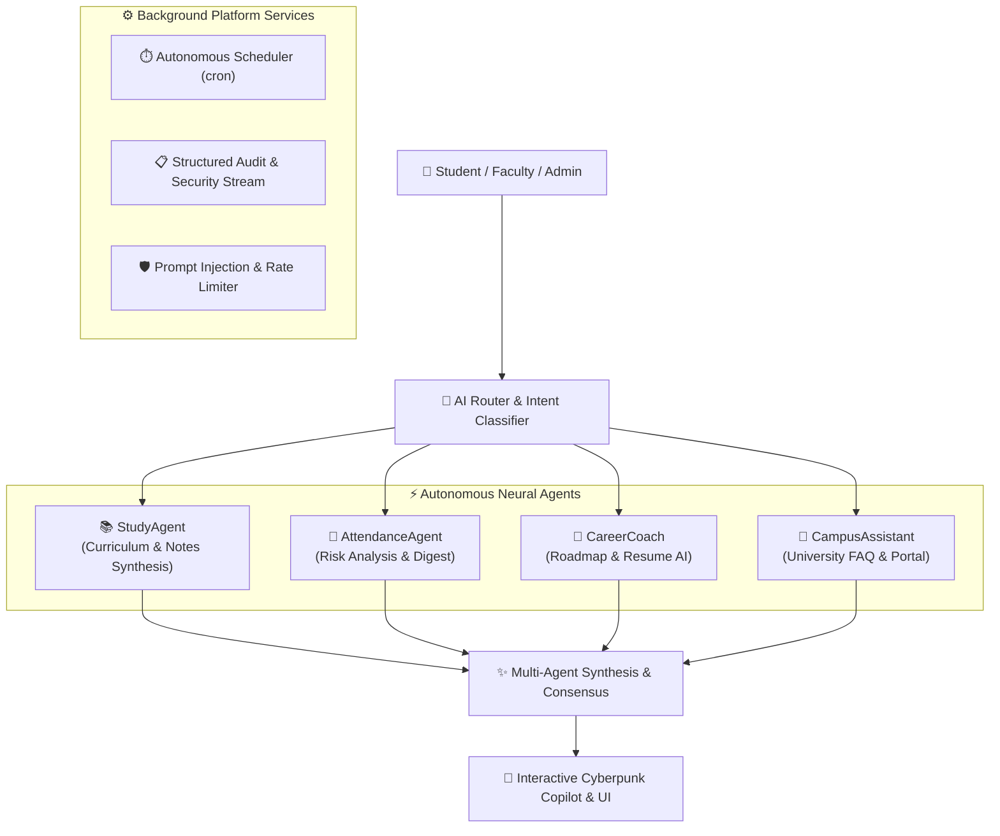

# 🎓 Campus AI — Autonomous Multi-Agent Higher Education Operating System

[](https://github.com)
[](https://github.com)
[](https://github.com)
[](https://opensource.org/licenses/MIT)

> **The next-generation autonomous AI ecosystem that unifies university governance, academic study assistance, attendance tracking, and career coaching into a single, proactive neural workspace.**

---

## 💡 1. Problem Statement & Solution

### The Problem
Traditional higher education software is fragmented, reactive, and manual:
- Students juggle disconnected learning management systems (LMS), static notes, and generic career advice.
- Faculty spend hours manually tracking attendance, grading assignments, and diagnosing student fall-off.
- University administrators lack real-time visibility into academic health, club activities, and AI utilization.

### The Solution: Campus AI
**Campus AI** introduces an **Autonomous Multi-Agent AI Platform** where intelligent neural agents continuously collaborate in the background to proactively assist students, faculty, and administrators:
- **Zero-Friction Multi-Agent Synthesis**: An AI router dynamically delegates complex queries across specialized neural agents (`StudyAgent`, `AttendanceAgent`, `CareerCoach`, `CampusAssistant`).
- **Autonomous Workflow Automation**: Background cron schedulers automatically generate attendance digests, study roadmaps, note summaries, and risk alerts without manual intervention.
- **Glassmorphic Cyberpunk UI**: Built with a curated design system featuring micro-interactions, real-time agent execution timelines, and responsive layouts.

---

## 🏛️ 2. Architecture & Multi-Agent Ecosystem



### Key AI Agents
1. **`StudyAgent`**: Summarizes lecture notes, generates interactive study guides, and crafts personalized curriculum roadmaps.
2. **`AttendanceAgent`**: Monitors attendance thresholds, flags students at risk of falling below attendance requirements, and automates notifications.
3. **`CareerCoach`**: Evaluates student resumes against live industry standards, identifies skill gaps, and recommends targeted hackathons and internships.
4. **`CampusAssistant`**: Acts as the first-line concierge for university policies, administrative procedures, and portal navigation.

---

## ⭐ 3. Detailed Features

### For Students
- **Neural AI Copilot**: Ask questions and watch the **Live Agent Workflow Execution Timeline** trace from query routing to agent synthesis.
- **AI Resume Analyzer & Roadmap Generator**: Upload resumes for instant ATS scoring and custom skill roadmaps.
- **Notes Summarizer**: Automatically distill lengthy lecture notes into actionable cheat sheets.

### For Faculty & Club Administrators
- **Faculty Overview & Calendar**: Proactive class management, lecture schedules, and automated student attendance tracking.
- **Club Management**: Approve student club memberships, manage university hackathons, and publish events.

### For University Principal Administrators
- **Real-Time System & AI Execution Logs Monitor**: Live telemetry streaming every agent execution, latency metric, and security audit event.
- **Role-Based Access Control (RBAC)**: Fine-grained security permissions across Student, Faculty, Club Admin, and Principal Admin roles.

---

## 🛠️ 4. Technology Stack

- **Frontend**: React 18, TypeScript, Vite, Tailwind CSS, Framer Motion, Lucide Icons
- **Backend**: Node.js, Express.js, Custom SQLite/MySQL Data Access Layer
- **AI Engine**: Multi-Agent Orchestration with Prompt Injection Defense and Input Sanitization
- **DevOps & Security**: Docker, Docker Compose, Helmet, High-Performance Rate Limiter, In-Memory Audit Logger

---

## 🚀 5. Hackathon Judge Preview (Demo Mode)

Judges can test 100% of Campus AI immediately without creating an account:
1. Open the Login page at `http://localhost/login` (or `http://localhost:5173/login` in dev mode).
2. Click the **"🚀 Explore as Hackathon Judge (Demo Mode)"** button.
3. You will be instantly authenticated as an Administrator with pre-seeded attendance, assignments, notes, analytics, and live AI logs.

---

## 📦 6. Installation & Setup

### One-Command Docker Launch (Recommended)
```bash
# Clone the repository
git clone https://github.com/your-username/campus-ai.git
cd campus-ai

# Start Backend, Frontend, and Database containers
docker-compose up --build -d
```
- **App URL**: `http://localhost`
- **Health Check**: `http://localhost:5000/health`

### Local Development Setup
#### 1. Backend Server
```bash
cd backend
npm install
npm run dev
# Running on http://localhost:5000
```

#### 2. Frontend Application
```bash
cd frontend
npm install
npm run dev
# Running on http://localhost:5173
```

---

## 🔌 7. API Documentation

| Endpoint | Method | Role | Description |
| :--- | :---: | :---: | :--- |
| `/api/auth/login` | `POST` | Public | Authenticates user and returns JWT token |
| `/api/ai/chat` | `POST` | All | Delegates prompt to AI Router & multi-agent synthesis |
| `/api/study-agent/summarize` | `POST` | Student | Generates study summaries from notes/lectures |
| `/api/admin/overview` | `GET` | Admin | Fetches platform KPI metrics and system stats |
| `/api/admin/logs` | `GET` | Admin | Streams live system and AI execution audit logs |
| `/api/admin/seed-demo` | `POST` | Admin | Seeds realistic demo data for hackathon judges |
| `/health` | `GET` | Public | Returns JSON system health & agent status |

---

## 📁 8. Folder Structure

```
d:/campus/
├── backend/
│   ├── controllers/      # Route controllers (admin, faculty, student, AI)
│   ├── middleware/       # Security, Auth, Rate Limiter, Prompt Injection defense
│   ├── routes/           # Modular REST API routes
│   ├── services/         # Autonomous Scheduler, AI Agent Router, Logger
│   ├── server.js         # Central server hub & diagnostics
│   └── Dockerfile        # Production Node.js container build
├── frontend/
│   ├── src/
│   │   ├── components/   # Reusable UI tokens (GlassCard, AICopilot, Layouts)
│   │   ├── pages/        # Role-based pages (Admin, Faculty, Club, Student)
│   │   ├── utils/        # Tailwind class merge utilities
│   │   └── App.tsx       # Route definitions & Suspense LoadingSkeleton
│   └── Dockerfile        # Multi-stage Vite + Nginx build
├── docker-compose.yml    # Root orchestration config
└── DEPLOYMENT.md         # Comprehensive deployment guide
```

---

## 🔮 9. Future Scope

1. **Voice-Activated Neural Assistant**: Real-time voice interaction with `CampusAssistant` using WebRTC.
2. **Predictive Student Dropout AI**: ML classifier trained on attendance and assignment grades to predict academic risk 4 weeks in advance.
3. **Decentralized Academic Credentials**: Verifiable blockchain-based degree and club leadership certificates.

---

<p align="center">
  <b>Built with ❤️ by the Campus AI Team for Hackathon 2026</b>
</p>
